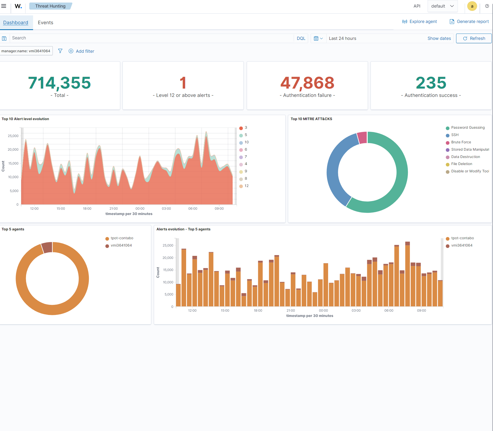
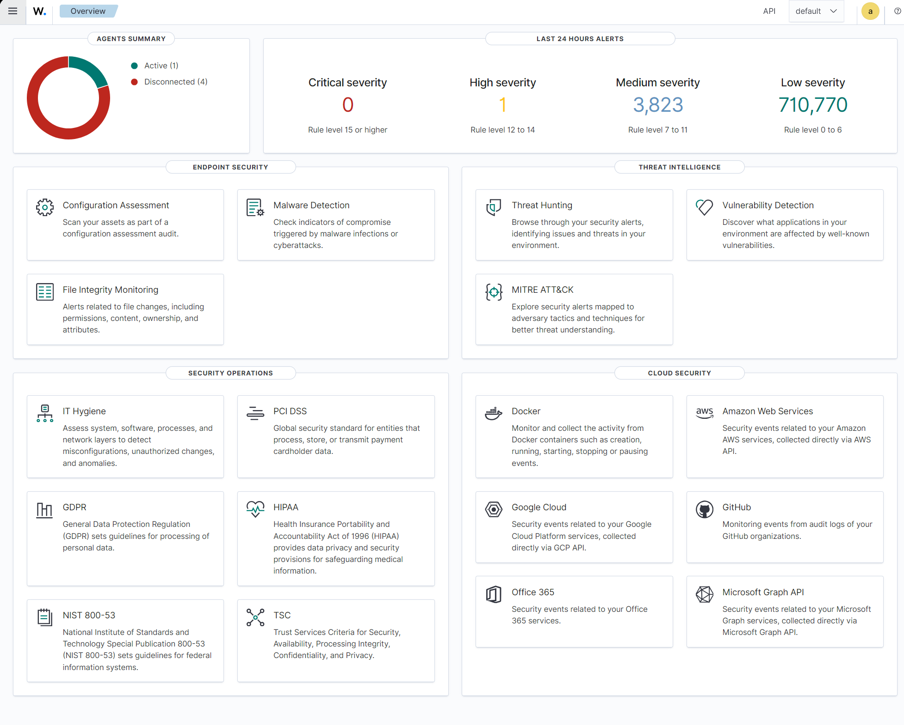
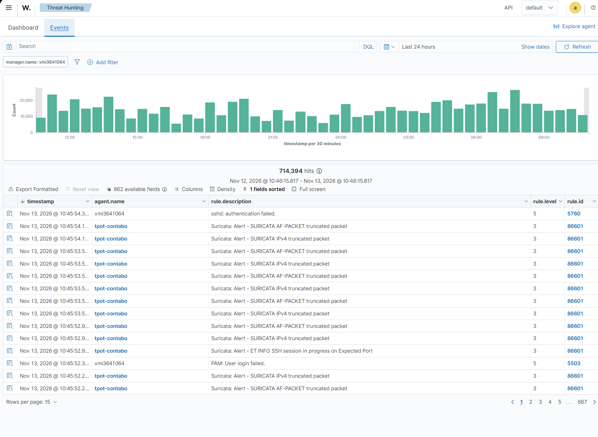
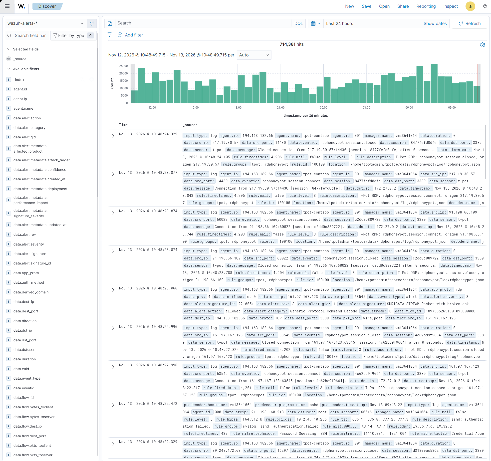

# 🛡️ Wazuh · Descarga e instalación

**W4lterSec** · Guía en español · Capturas del laboratorio

Una presentación de Wazuh para empezar un laboratorio de monitorización, explorar alertas e investigar eventos de seguridad.

**[⬇ Descargar asistente oficial](https://packages.wazuh.com/4.14/wazuh-install.sh)** · **[📖 Instalación oficial](https://documentation.wazuh.com/current/quickstart.html)** · **[💻 Código fuente](https://github.com/wazuh/wazuh)**

> Wazuh es una plataforma de seguridad de código abierto con capacidades SIEM y XDR. Este repositorio reúne una guía y capturas de **W4lterSec**; el software y su documentación proceden del proyecto oficial.



## 1. Preparar el equipo

Para un laboratorio de **1 a 25 agentes**, la guía rápida recomienda:

| Recurso | Recomendación |
| --- | --- |
| Procesador | 4 vCPU |
| Memoria | 8 GiB RAM |
| Almacenamiento | 50 GB para 90 días de alertas |
| Sistema | Linux de 64 bits compatible; por ejemplo, Ubuntu 24.04 |

Usa un equipo o máquina virtual dedicado, con acceso a Internet, `curl` y permisos de administración. Comprueba los [requisitos oficiales](https://documentation.wazuh.com/current/quickstart.html#requirements).

## 2. Descargar e instalar

La instalación **todo en uno** reúne servidor, indexador y dashboard en el mismo equipo.

En la terminal del Linux preparado para Wazuh:

```bash
curl -sO https://packages.wazuh.com/4.14/wazuh-install.sh
sudo bash ./wazuh-install.sh -a
```

Revisa la salida del asistente y guarda las credenciales generadas en un lugar privado.

## 3. Abrir el panel

Accede desde el navegador:

```text
https://IP_DE_TU_WAZUH
```

Utiliza el usuario **admin** y la contraseña generada por el instalador.

## 4. Añadir agentes

Desde **Agents management → Summary → Deploy new agent**, selecciona el sistema del equipo que quieres monitorizar y sigue las instrucciones del panel.

También puedes consultar la [instalación oficial de agentes](https://documentation.wazuh.com/current/installation-guide/wazuh-agent/index.html) para Linux, Windows o macOS.

## 5. Recorrido visual del laboratorio

### 📈 Threat Hunting · Dashboard

La imagen de cabecera muestra la evolución temporal, los fallos y éxitos de autenticación y las asociaciones con técnicas MITRE ATT&CK. Es un punto de partida para priorizar qué registros investigar.

Las cifras pertenecen al momento y a los filtros de cada captura; no equivalen a un número de ataques bloqueados.

### 🏠 Overview · Estado general

Resumen de agentes, alertas por severidad y accesos a los módulos. En esta captura aparecen **un agente activo y cuatro desconectados**.



### 📋 Threat Hunting · Events

Vista tabular para revisar fecha, agente, descripción, nivel e identificador de regla. Se observan eventos de autenticación y alertas de Suricata.



### 🔎 Discover · Investigar los registros

Consulta de `wazuh-alerts-*` con histograma y campos de los eventos. La captura incluye registros de T-Pot recibidos por Wazuh.



Las capturas documentan este laboratorio. La integración específica con T-Pot no se configura en los pasos de instalación base de esta guía.

## Créditos y recursos

- **Software:** [Wazuh / wazuh](https://github.com/wazuh/wazuh).
- **Instalación y requisitos:** [Quickstart oficial](https://documentation.wazuh.com/current/quickstart.html).
- **Documentación de agentes:** [Wazuh agent](https://documentation.wazuh.com/current/installation-guide/wazuh-agent/index.html).
- **Guía y capturas de esta presentación:** W4lterSec.

Documentación consultada el **13 de noviembre de 2026**. Los comandos corresponden a la rama **4.14** indicada en la guía rápida en esa fecha; comprueba siempre la fuente oficial antes de instalar.
